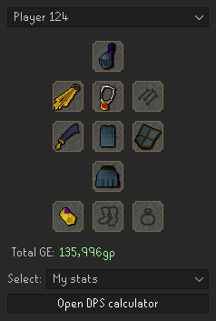
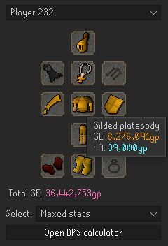
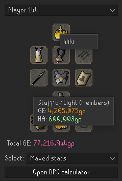

<h1>
  
  Player Inspector
</h1>

Inspect the equipment of nearby players.

<table>
  <tr>
    <td align="center"></td>
    <td align="center"></td>
    <td align="center"></td>
  </tr>
  <tr>
    <td align="center">Equipment and total value</td>
    <td align="center">GE / high alch prices on hover</td>
    <td align="center">Right-click for the wiki page</td>
  </tr>
</table>

## Usage

Right-click a player and click **Inspect** to open the side panel.
Or select a nearby player from dropdown menu in sidebar.

## Features

### Inspect Equipment
The full worn setup of the selected player, laid out like the in-game equipment tab

### Prices on hover 
Grand Exchange and high alchemy value per item, colour-coded by worth

### Total GE value
Combined tradeable value of the whole setup

### Wiki item lookup 
Right-click any item to open its OSRS Wiki page.

### DPS calculator
Send the loadout to the [OSRS Wiki DPS calculator](https://tools.runescape.wiki/osrs-dps/). Pick whose levels to calculate with:
- **My stats** - your own levels
- **Maxed stats** - a flat 99 in every combat skill

Disabled by default - enable **Wiki DPS calculator** in the plugin settings.

## Limitations

- The game only informs about the equipment that is actually *drawn* on a
  player's model. Rings and ammo aren't rendered, so **they are never available
  for other players**.

## License

BSD 2-Clause — see [LICENSE.txt](LICENSE.txt).
